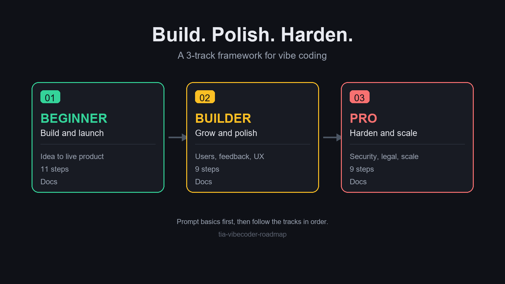

# TIA Vibecoder Roadmap

**Build. Polish. Harden.** A 3-track framework for vibe coding.



## What is this?

A practical roadmap for solo builders who use AI to build real products. It is
not a list of tools. It is a sequence. You move through three tracks, one after
the other, and each one unlocks the next.

| Track | Goal | Focus |
|-------|------|-------|
| 🟢 Beginner | Build and launch | Idea to live product |
| 🟡 Builder | Grow and polish | Users, feedback, UX |
| 🔴 Pro | Harden and scale | Security, legal, scale |

## The philosophy

Three rules. Everything else in this repo follows from them.

1. **Build first.** A working product with rough edges beats a perfect plan.
2. **Polish second.** Get real users before you fix the pixel that annoys you.
3. **Harden last.** Do not spend a week on security for a product nobody uses yet.

Ship before overthinking. Most vibe coding projects die in the setup phase, not
the build phase. Move faster than it feels comfortable.

## How to use this repo

1. Read [`docs/00-prompt-basics.md`](docs/00-prompt-basics.md) first. Ten
   minutes there will save you ten hours later.
2. Work through the tracks **in order**. Do not skip to Pro.
3. Each track file is a checklist. One section per step, finish a step before
   moving to the next.
4. You do not need to finish a track on a schedule. Finish it before you need
   what comes next.

| Order | Track | File |
|-------|-------|------|
| 00 | Prompt basics | [`docs/00-prompt-basics.md`](docs/00-prompt-basics.md) |
| 01 | 🟢 Beginner | [`docs/01-beginner.md`](docs/01-beginner.md) |
| 02 | 🟡 Builder | [`docs/02-builder.md`](docs/02-builder.md) |
| 03 | 🔴 Pro | [`docs/03-pro.md`](docs/03-pro.md) |

## Repo structure

```
tia-vibecoder-roadmap/
├── README.md              # You are here
├── LICENSE                # MIT, for code
├── LICENSE-CONTENT        # CC BY 4.0, for docs and framework
├── CONTRIBUTING.md        # How to help
├── docs/
│   ├── 00-prompt-basics.md
│   ├── 01-beginner.md
│   ├── 02-builder.md
│   └── 03-pro.md
└── assets/
    └── flow.png
```

## License

This repo is dual licensed.

- **Code**: MIT. See [`LICENSE`](LICENSE).
- **Content** (docs, framework, diagrams): CC BY 4.0. See
  [`LICENSE-CONTENT`](LICENSE-CONTENT).

Use it freely. Credit us. If you fork it, keep the attribution.

## Credits

Built by the TIA team.

- Profile: [github.com/tiasolveit](https://github.com/tiasolveit)

## Contributing

Issues and pull requests are welcome. Read
[`CONTRIBUTING.md`](CONTRIBUTING.md) first.